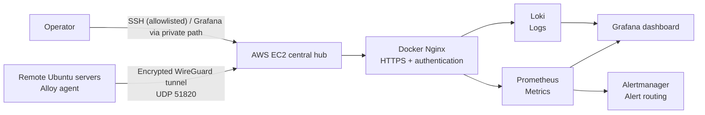

# ObStack Beginner's Guide — From AWS Setup to First Telemetry

> **Audience:** A first-time operator who has never deployed a monitoring platform.
>
> **Important:** This is a guided, staged rollout. Reading and preparing this guide does not deploy anything. Do not proceed to steps marked **CHANGE WINDOW / APPROVAL REQUIRED** until the architecture, addresses, inventory and access plan have been reviewed. ObStack is currently a repository implementation; its runtime deployment and pilot acceptance are not yet verified.

## What you will build

ObStack is designed to collect metrics and logs from remote Ubuntu servers. The repository provides central ingestion endpoints and an Alloy starter configuration, but remote application enrollment, log sources, and host/container-agent operation still require review and verification. This guide describes a staged pilot; it does not assert that remote telemetry currently arrives.

- Central host: AWS EC2, Ubuntu 24.04 LTS, ARM64, 2 vCPU, 2 GB RAM, 14 GB disk.
- Remote hosts: Ubuntu 24.04 LTS; fleet currently planned as five AMD64 and five ARM64.
- Central services: Dockerized Nginx, Prometheus, Loki, Grafana, Alertmanager and Blackbox Exporter.
- Secure transport: WireGuard private hub-and-spoke network, plus HTTPS and separate per-host metrics/logs credentials.
- Retention objectives: 30 days of metrics and 20 days of logs. These are targets, not guarantees on the small disk; pilot measurement must prove them.
- Central host timezone: Africa/Lagos.

### Picture the flow



This is the intended design, not a live connection diagram. Do not open Grafana, Prometheus, Loki or other backend ports directly to the public internet.

## Before starting: collect these items

Use this checklist. If a value is unknown, pause and obtain it—do not invent network addresses.

- [ ] AWS account access with permission to view/create EC2, VPC, subnet, Elastic IP and Security Group resources.
- [ ] GitHub access to the private repository [0FFSIDE1/ObStack](https://github.com/0FFSIDE1/ObStack).
- [ ] A trusted computer for running the commands (Linux, macOS, or Windows with WSL2).
- [ ] SSH access to the central EC2 and pilot remote servers.
- [ ] Confirmed administrator public IPv4 address/CIDR for SSH allowlisting.
- [ ] Verified static public egress IPv4 addresses for the pilot remote servers.
- [ ] Approved VPC CIDR and WireGuard overlay CIDR. **The proposed 10.77.0.0/24 is only a proposal.** Check for overlap with AWS VPC, home/office VPNs and each server's Docker networks first.
- [ ] A plan for a protected secret manager / encrypted vault and off-host backups.
- [ ] Approval for the change window before making any host, network or firewall change.

## Step 1 — Open the repository and read the design

1. Open the GitHub repository.
2. Read these documents in order:
   1. `docs/architecture.md`
   2. `docs/network-architecture.md`
   3. `docs/implementation-plan.md`
   4. `docs/telemetry-ingestion.md`
   5. `docs/operations/ports-capacity-failure-modes.md`
   6. `docs/security/threat-model.md`
3. Make a list of the central server and pilot remote server names. Start with one AMD64 and one ARM64 machine if available.
4. Do not proceed if the address plan or SSH access/rollback plan is not approved.

## Step 2 — AWS Console: verify the AWS region and Elastic IP

1. Sign in to the [AWS Management Console](https://console.aws.amazon.com/).
2. In the top-right region selector, choose the AWS region where the existing Elastic IP was allocated. An Elastic IP is regional.
3. Search for **EC2** and open the EC2 console.
4. In the left navigation, under **Network & Security**, open **Elastic IP addresses**.
5. Find the existing Elastic IP and record its address and allocation ID in your private deployment worksheet.
6. Confirm the status/association. If it is not associated, record that; association to the future EC2 instance is a later approved change. Do not release the address.
7. Under **Instances**, check whether an appropriate central instance already exists. Do not alter or terminate any instance as part of this guide.

**Console screenshot checklist (capture screenshots from your own AWS account):**
- **Figure 1 — AWS region selector and EC2 dashboard:** region visible, account identifiers blurred.
- **Figure 2 — Elastic IP addresses page:** show allocation and association status; blur unrelated IPs and account identifiers.
- **Figure 3 — VPC dashboard / Your VPCs:** show the chosen VPC and CIDR; redact unrelated networks.

AWS reference pages (these are instructions, not screenshots of your account):
- [EC2 Elastic IP addresses](https://docs.aws.amazon.com/AWSEC2/latest/UserGuide/elastic-ip-addresses-eip.html)
- [VPCs and CIDR blocks](https://docs.aws.amazon.com/vpc/latest/userguide/vpc-cidr-blocks.html)

## Step 3 — AWS Console: create or select a VPC and subnet

**Do not select a CIDR by guess.** The VPC and WireGuard CIDRs must be checked against every existing network route and Docker bridge.

1. In AWS Console, search **VPC**.
2. Open **Your VPCs**. Choose the already-approved VPC, or create one only after CIDR approval.
3. Record VPC ID, IPv4 CIDR, region and name tag.
4. Open **Subnets** and select/create the approved subnet in the chosen Availability Zone. Record subnet ID and CIDR.
5. Confirm the subnet's route table and internet connectivity design. The central host needs outbound connectivity for Ubuntu packages and container image pulls.
6. Keep the VPC CIDR and subnet CIDR in the private worksheet. Do not paste credentials into tags or notes.

**Figure 4 — VPC detail page:** show VPC name/ID and IPv4 CIDR; blur account IDs.
**Figure 5 — Subnet detail page:** show subnet ID, CIDR and Availability Zone.

Reference: [Create a VPC](https://docs.aws.amazon.com/vpc/latest/userguide/create-vpc.html).

## Step 4 — AWS Console: create the EC2 central host (approved change)

This step creates a billable resource and changes AWS. Obtain explicit approval first.

1. EC2 console → **Instances** → **Launch instances**.
2. Name it something descriptive, such as `obstack-central`.
3. Choose Ubuntu Server **24.04 LTS** AMI for **ARM64** (not x86/AMD64).
4. Choose the approved instance type that meets the fixed target: 2 vCPU and 2 GiB RAM. Check the architecture is ARM64.
5. Select the approved VPC and subnet.
6. Configure a key pair. Create/download it only if authorized. Store the private key in a secure location and restrict access; never upload it to GitHub or commit it.
7. Configure storage for the approved 14 GB disk. Check the root volume is encrypted.
8. Choose or create the Security Group from Step 5.
9. Launch. Wait until **Instance state: Running** and **Status checks: 2/2 passed**.
10. Record instance ID, private IP, public IP (if assigned), AMI and volume size in the private worksheet.

**Figure 6 — Launch instance review:** redact key-pair name if sensitive, account ID and unrelated fields.
**Figure 7 — Instance details / status checks:** instance state and checks visible.

Reference: [Launch an EC2 instance](https://docs.aws.amazon.com/AWSEC2/latest/UserGuide/launching-instance.html).

## Step 5 — AWS Console: configure the central Security Group

The intended minimum inbound access is:

| Rule | Protocol/port | Source | When |
|---|---|---|---|
| SSH | TCP 22 | Administrator's verified public IPv4 CIDR only (e.g. a single address with /32) | Management |
| WireGuard | UDP 51820 | Verified public egress IPv4 /32 for each enrolled remote server | Required for the VPN hub |
| HTTPS | TCP 443 | **Do not allow public internet access.** Later it is reachable only through the WireGuard interface/private overlay as approved. | After tunnel setup |

1. EC2 → **Security Groups** → choose the central host's group.
2. Open **Inbound rules** → **Edit inbound rules**.
3. Keep SSH restricted to the administrator IP/CIDR. Do not use `0.0.0.0/0` for SSH.
4. Add UDP 51820 only after the actual remote egress IP addresses have been verified and approved. During an initial empty pilot, do not add broad ingress.
5. Keep TCP 443 closed to public sources. The bootstrap Nginx binding is loopback-only; later Nginx binds to the WireGuard IP.
6. Save only within the approved change window.
7. Check the **Outbound rules** and apply the approved egress policy; package repositories and container registries need outbound access.

**Figure 8 — Security Group inbound rules:** screenshot showing SSH restricted to admin CIDR and UDP 51820 restricted to enrolled peer addresses; no public 443. Blur source IPs if the documentation is shared publicly.

Reference: [Security Group rules](https://docs.aws.amazon.com/AWSEC2/latest/UserGuide/security-group-rules.html).

> **Never add inbound rules for 3000, 9090, 3100, 9093 or 9115.** These are backend/service ports and must remain loopback-bound.

## Step 6 — Prepare your computer (Ansible controller)

The computer that runs Ansible is called the **controller**. It connects to servers over SSH and sends them instructions.

### Ubuntu / Debian / WSL2 commands

```bash
sudo apt update
sudo apt install -y git python3 python3-venv python3-pip openssh-client wireguard-tools
git clone https://github.com/0FFSIDE1/ObStack.git
cd ObStack
python3 -m venv .venv
source .venv/bin/activate
python -m pip install --upgrade pip
python -m pip install ansible-core==2.18.6 ansible-lint
ansible-galaxy collection install -r ansible/requirements.yml
```

If the repository is private, Git will prompt for a valid authentication method. Use GitHub's recommended authentication (SSH key or credential manager); do not put a token in the clone URL.

Check tools:

```bash
git --version
ansible --version
ansible-lint --version
```

## Step 7 — Verify SSH access (read-only)

1. Ensure the EC2 key file is saved safely. On Linux/WSL, restrict its permissions:

```bash
chmod 600 /secure/location/central-key.pem
ssh -i /secure/location/central-key.pem ubuntu@CENTRAL_PUBLIC_IP
```

Replace `CENTRAL_PUBLIC_IP` with the verified IP. The default Ubuntu EC2 login name is typically `ubuntu`; verify it against the selected AMI. Disconnect with `exit`.

2. Repeat SSH access verification for the two pilot remote servers using the approved account/key.
3. Confirm that the administrator source IP used by SSH is the exact CIDR planned for the host firewall.
4. Do not continue if SSH access is not stable or a recovery/console access path is unavailable.

## Step 8 — Prepare a host inventory (no secrets in this file)

The example inventory is `ansible/inventory/hosts.example.yml`. Copy it to a private working inventory file; never commit real inventory values if it exposes infrastructure.

```bash
cp ansible/inventory/hosts.example.yml ansible/inventory/hosts.yml
```

Edit the copy. For each host, fill in:
- host alias (e.g. `obstack-central`, `pilot-amd64`, `pilot-arm64`)
- verified SSH management address
- architecture: `arm64` for ARM64, `amd64` for AMD64
- approved unique WireGuard overlay address
- WireGuard public key (public keys can be in inventory; private keys cannot)
- remote static public egress IPv4 address for WireGuard allowlisting
- central Elastic IP and UDP port 51820 as each spoke endpoint
- project and environment labels

The group variable example is `ansible/inventory/group_vars/observability.yml.example`. Copy it to `ansible/inventory/group_vars/observability.yml` and fill the approved absolute repo path, admin CIDR and hub overlay IP:

```bash
mkdir -p ansible/inventory/group_vars
cp ansible/inventory/group_vars/observability.yml.example ansible/inventory/group_vars/observability.yml
```

Use YAML syntax carefully; quote strings that include special characters. Verify the final inventory:

```bash
ansible-inventory -i ansible/inventory/hosts.yml --graph
ansible-inventory -i ansible/inventory/hosts.yml --list
```

Do not use the provisional 10.77.0.0/24 overlay until it is formally approved and checked for overlap.

## Step 9 — Generate secrets and keys safely

All generated values below are secrets unless labeled public. Store the private outputs in an approved password manager or encrypted vault. Never send them in chat, email, tickets, screenshots, shell history, or Git commits.

### Strong random passwords (24+ characters)

On a trusted Linux/macOS terminal:

```bash
# Generate an individual random password (copy it directly into secure storage)
openssl rand -base64 32
```

Generate separate values for Grafana administrator, each host's metrics user, each host's logs user, and the Ansible Vault password. Do not reuse a password across hosts or purposes.

### WireGuard keypair for each host

Install `wireguard-tools` (Step 6). For each host, create a private/public keypair:

```bash
umask 077
wg genkey | tee wg-private.key | wg pubkey > wg-public.key
chmod 600 wg-private.key
```

- `wg-private.key`: **secret**, never put it in inventory or Git.
- `wg-public.key`: public key; put the value in the relevant inventory host variable.
- Create a unique keypair for central and every remote host.
- Avoid creating key material on a shared/public computer. Securely store the private key with host identity.
- The implementation expects controller environment variables named `OBSTACK_WG_PRIVATE_KEY_<HOST>`, where the inventory alias is uppercase and punctuation (such as hyphen) becomes underscore. Example alias `pilot-amd64` becomes `OBSTACK_WG_PRIVATE_KEY_PILOT_AMD64`.

The current project reads the WireGuard private keys and host telemetry passwords from the Ansible controller's environment. It does not yet provide a fully automated secrets-manager integration.

## Step 10 — Secret inventory (what is needed and when)

The table is the master checklist. A secret is added to GitHub only for the workflow that requires it; local Ansible runs use environment variables. Values are not to be placed in tracked files.

| Secret / value | Example naming | Purpose / stage | Where it is consumed |
|---|---|---|---|
| Grafana admin username | `OBSTACK_GRAFANA_ADMIN_USER` | Central setup/release | Controller environment; GitHub production environment secret |
| Grafana admin password (24+ chars) | `OBSTACK_GRAFANA_ADMIN_PASSWORD` | Central setup/release | Controller environment; GitHub production environment secret |
| Ansible Vault password | `OBSTACK_ANSIBLE_VAULT_PASSWORD` | Release workflow / Vault | GitHub production environment secret; local vault password file |
| SSH deploy private key | `OBSTACK_DEPLOY_SSH_PRIVATE_KEY` | CI release deployment | GitHub production environment secret; matches central host's authorized key |
| Production Ansible inventory YAML | `OBSTACK_ANSIBLE_INVENTORY` | CI release deployment | GitHub production environment secret; complete inventory document |
| WireGuard private key for central | `OBSTACK_WG_PRIVATE_KEY_OBSTACK_CENTRAL` (alias-dependent) | WireGuard setup | Controller environment only |
| WireGuard private key for each remote | `OBSTACK_WG_PRIVATE_KEY_<HOST>` | WireGuard setup | Controller environment only |
| Metrics password per host (24+ chars) | `OBSTACK_ALLOY_METRICS_PASSWORD_<HOST>` | Central Nginx auth + Alloy stage | Controller environment; must be securely held in Vault |
| Logs password per host (24+ chars) | `OBSTACK_ALLOY_LOGS_PASSWORD_<HOST>` | Central Nginx auth + Alloy stage | Controller environment; must be securely held in Vault |
| Optional Alertmanager webhook URL | `OBSTACK_ALERTMANAGER_WEBHOOK_URL` | Alert delivery | Controller environment; endpoint token is embedded in URL, protect it as a secret |
| Grafana Compose local env | `GRAFANA_ADMIN_USER`, `GRAFANA_ADMIN_PASSWORD` | Local/central Compose configuration | Root-only `.env` on central host; do not commit |

**Public, non-secret but sensitive infrastructure values:** VPC/subnet CIDRs, WireGuard addresses, host public IPs, public WireGuard keys, inventory aliases, SSH admin CIDR. Treat these as internal infrastructure data and redact them in public screenshots.

### GitHub repository/environment secrets (release pipeline)

1. Open the repository on GitHub.
2. Settings → **Environments** → create or open the environment named `production`.
3. Add the five release secrets listed above: inventory, SSH private key, Ansible Vault password, Grafana username and Grafana password.
4. Restrict the production environment to approved deployment branches/tags and configure required reviewers if your GitHub plan/settings support it.
5. Settings → Secrets and variables → Actions can be used for repository-level secrets if the project is configured to read them there, but prefer the `production` environment for deployment credentials.
6. Never paste secret values into screenshots. A screenshot should show only the secret names, not their values.

**Important current implementation note:** the release workflow checks these five secrets. WireGuard and per-host telemetry secrets are consumed by Ansible playbooks from controller environment variables, and must be deliberately wired into the approved deployment process before those stages are run. Do not assume adding them in GitHub alone makes them available to the workflow.

## Step 11 — Run read-only checks before changing any server

From the repository root, activate the Python virtual environment, then:

```bash
source .venv/bin/activate
ansible-playbook -i ansible/inventory/hosts.yml ansible/playbooks/preflight.yml
ansible-playbook -i ansible/inventory/hosts.yml ansible/playbooks/discover-alloy.yml
```

The preflight checks Ubuntu version and CPU architecture. Alloy discovery checks existing agent/container ownership and configuration in a read-only way. If a host is not Ubuntu 24.04 or architecture is not ARM64/AMD64, stop and review rather than bypassing the check.

Also run the repository CI validation workflows by opening GitHub → **Actions**. The expected checks include Ansible syntax/lint, Compose and service configuration validation. A passing CI run checks files; it does not prove hosts are deployed or telemetry is flowing.

## Step 12 — First central deployment (approval required)

**Do not run until:** AWS host exists; SSH verified; inventory and address plan are approved; secrets are securely prepared; CI is green; a change window and rollback plan are approved.

For a local controller, set required environment variables using a secure secret manager or protected terminal session. The following demonstrates variable names only; values must come from your protected secret store:

```bash
export OBSTACK_GRAFANA_ADMIN_USER='admin'
export OBSTACK_GRAFANA_ADMIN_PASSWORD='REPLACE_FROM_SECRET_STORE'
# Export the unique per-host metrics and logs passwords as well.
# Do not type real secrets into shell history on a shared computer.
```

Then perform the explicit mutating deployment:

```bash
ansible-playbook -i ansible/inventory/hosts.yml ansible/playbooks/central.yml \
  --private-key /secure/location/central-key.pem \
  -e obstack_apply=true \
  -e obstack_repo_root="$PWD"
```

The playbook installs/configures the central host, Docker, private CA/server certificate and Compose services. It checks the central host is Ubuntu 24.04 ARM64 and uses Africa/Lagos timezone. This changes the server. Watch the output and stop on errors; do not repeatedly rerun without understanding the error.

At the initial bootstrap, Nginx binds to loopback. That is intentional; no public HTTPS ingress is expected.

## Step 13 — Configure WireGuard hub and pilot spokes (approval required)

1. Confirm final approved overlay CIDR and every host's unique overlay address.
2. Confirm each remote's actual static public egress IPv4 address and the central Elastic IP.
3. Confirm each keypair public key is in inventory and private keys are securely available in controller environment variables.
4. Add approved remote egress IPs as narrowly scoped UDP 51820 inbound rules in the AWS Security Group. The Ansible host firewall policy is also restrictive; check both AWS and host firewall.
5. With a reviewed maintenance window, run:

```bash
ansible-playbook -i ansible/inventory/hosts.yml ansible/playbooks/wireguard.yml \
  --private-key /secure/location/central-key.pem \
  -e obstack_apply=true
```

6. Verify WireGuard handshakes, routes and peer addresses before proceeding. Do not enable default-route/full-tunnel behavior, spoke-to-spoke access or public TCP 443.
7. If any handshake fails, troubleshoot the actual key, endpoint, UDP allowlist and routes. Do not widen the source rule to all internet addresses.

## Step 14 — Distribute the public CA certificate (approval required)

After central certificates exist and the pilot tunnel is verified, distribute the public CA only:

```bash
ansible-playbook -i ansible/inventory/hosts.yml ansible/playbooks/distribute-ca.yml \
  --private-key /secure/location/central-key.pem \
  -e obstack_apply=true --limit pilot-amd64,pilot-arm64
```

This playbook copies `ca.crt`, not the private CA key. Limit it to the approved pilot hosts first.

## Step 15 — Validate the central platform

Run the read-only validation playbook:

```bash
ansible-playbook -i ansible/inventory/hosts.yml ansible/playbooks/validate-central.yml \
  --private-key /secure/location/central-key.pem
```

It checks service readiness, TLS certificate trust, the Prometheus remote-write receiver, and authenticated/unauthenticated endpoint behavior. A successful playbook is a required checkpoint, not a substitute for end-to-end remote telemetry testing.

Once WireGuard and Nginx TLS are verified, the operator may approve changing Nginx's binding to the WireGuard IP. Public AWS TCP 443 remains closed.

## Step 16 — Discover Alloy and review telemetry sources (approval required)

1. Review the output from `discover-alloy.yml`: identify current container owner, image, config mounts, secrets mounts and data sources. Do not create a second Alloy agent on a host that already has one.
2. Do not stage/adopt the starter config as proof of log collection: it has no log source, bounded buffer, or agent health path.
3. Application registration currently rejects enabled logs and host monitoring. Keep those features disabled until the log source, privilege model, supported architectures, install lifecycle, health reporting, bounded buffering, and rollback plan are approved and implemented. The application metrics scrape path is separate and requires the approved WireGuard CIDR plus verified target and Laravel-observed source.
4. `alloy-onboarding.yml` defaults to preserve and does not install, restart or reconfigure the existing agent. Do not set `obstack_alloy_existing_policy=adopt` until a specific source design is reviewed.

The central Loki and remote-write endpoints are available for a future approved collector, but configuring a receiver does not establish an active sender.

## Step 17 — Verify only configured telemetry paths

Use the private approved access path to Grafana. Do not publish its backend port.

1. Sign in with the Grafana admin username/password created during central deployment.
2. Open the provisioned **ObStack Central Overview** dashboard.
3. Check central services and Prometheus targets. Empty remote panels are expected until an application has a validated registration and authorized path.
4. Verify a remote app scrape or health probe only after its target has been supplied, generated, reviewed, and enabled. `/up` is liveness, not dependency readiness.
5. Do not claim remote logs or host/container metrics are present; those sources are not enabled by the current onboarding contract.
6. Measure actual disk growth and memory/CPU use during an approved staging pilot. The 14 GB central disk is constrained; prove retention targets against real ingest volume.

**Figure 9 — Grafana dashboard:** capture a pilot dashboard with non-sensitive host labels only. Blur IPs, customer names, tokens and log contents.
**Figure 10 — Grafana Explore logs:** capture only after an approved source is implemented, verified, and its content has been redacted.

## Step 18 — Release using GitHub Actions (only after pipeline readiness)

The release workflow is intended to run on a version tag in the format `vMAJOR.MINOR.PATCH`, for example `v1.0.0`.

1. Ensure the release commit is merged to `main`.
2. Ensure CI validation checks pass.
3. Confirm GitHub **production** environment secrets and reviewer restrictions are set.
4. Confirm the workflow has been verified end-to-end in a safe staging target. The current release workflow is not proof that the first deployment is ready.
5. From a local checkout, create and push a version tag only after approval:

```bash
git checkout main
git pull --ff-only
git tag -a v1.0.0 -m "ObStack release v1.0.0"
git push origin v1.0.0
```

6. GitHub → **Actions** → open **Release and deploy ObStack** → inspect the validation jobs and deployment job.
7. If a workflow fails, open its run and read the first failing step. Do not repeat a tag/deploy attempt blindly. Use a new patch version tag for a corrected release according to the team's release policy.

## Step 19 — Add the rest of the server fleet in batches

After both pilot architectures pass end-to-end checks:
1. Add three or four hosts at a time to the approved inventory.
2. Give every host its own WireGuard keypair, unique overlay IP, metrics password and logs password.
3. Verify static public egress IP and project/environment labels.
4. Run read-only preflight and Alloy discovery before changing it.
5. Apply WireGuard/CA/Alloy changes only within approved change windows.
6. Check telemetry/auth, CPU/RAM/disk, and log redaction after each batch.
7. Do not assume ten hosts will fit on the constrained central host without measuring actual ingestion and cardinality.

## Step 20 — Everyday use and troubleshooting

### Everyday operator routine
- Open Grafana through the approved private access path.
- Use the ObStack overview dashboard to check central service/target health.
- Use Explore for metrics/log searches; filter by project, environment and server labels.
- Review alert notifications only after a real HTTPS webhook destination has been configured and delivery tested. By default, the Alertmanager receiver is a sink and sends no messages.
- Monitor central disk free space, memory pressure and ingestion rate. Filesystem free-space alerting, backup/restore, RPO/RTO and certificate renewal automation remain operational work items.

### Common problems

| Symptom | First safe check |
|---|---|
| SSH timeout | Check EC2 instance running/status checks, current admin public IP and restricted TCP 22 rule. Do not open SSH to everyone. |
| Ansible cannot connect | Check inventory SSH address, username/key permissions and whether the key matches the instance. |
| WireGuard has no handshake | Verify public keys, endpoint Elastic IP, UDP 51820 source allowlist, peer address uniqueness and remote egress IP. |
| HTTPS certificate error | Confirm remote CA file is the public ObStack CA and URL IP matches certificate SAN. Do not turn off TLS verification. |
| Metrics/logs return 401 | Verify the correct per-host credential and rotation status; never disable Basic Auth. |
| Grafana dashboard is empty | Verify Alloy is running and actually mounted with config, CA and password files; check central target/service status and label filters. |
| Disk space rapidly falls | Measure Prometheus/Loki growth and filesystem headroom; do not manually delete active service files. Retention settings alone are not disk capacity assurance. |
| Alert does not arrive | Check whether the optional webhook URL is set and the receiver has been tested; unset receiver is intentionally non-delivery. |

## Snapshot capture and documentation policy

The guide identifies the AWS console screens that operators should capture at the moment they create/verify their own resources. **This repository guide does not embed screenshots taken from your AWS account** because no AWS console account session was available to capture authentic resource state. Do not substitute screenshots with fabricated IDs, IPs, account numbers or settings.

For each figure above:
- Capture from your own AWS console at the corresponding step.
- Blur AWS account ID, private keys, credentials, unrelated IPs/resources, sensitive names and any customer data.
- Keep a date and note whether the screen reflects a proposed or deployed state.
- Save images under `docs/images/beginner-guide/` and replace the figure instruction with a relative Markdown image reference only after review.

## Related project documents

- [Architecture](architecture.md)
- [Network architecture](network-architecture.md)
- [Implementation plan](implementation-plan.md)
- [Implementation status](implementation-status.md)
- [Telemetry ingestion](telemetry-ingestion.md)
- [Operations: ports, capacity and failure modes](operations/ports-capacity-failure-modes.md)
- [Threat model](security/threat-model.md)
- [Preliminary ISO/IEC 27002 mapping](security/iso-27002-2022-preliminary-mapping.md)
