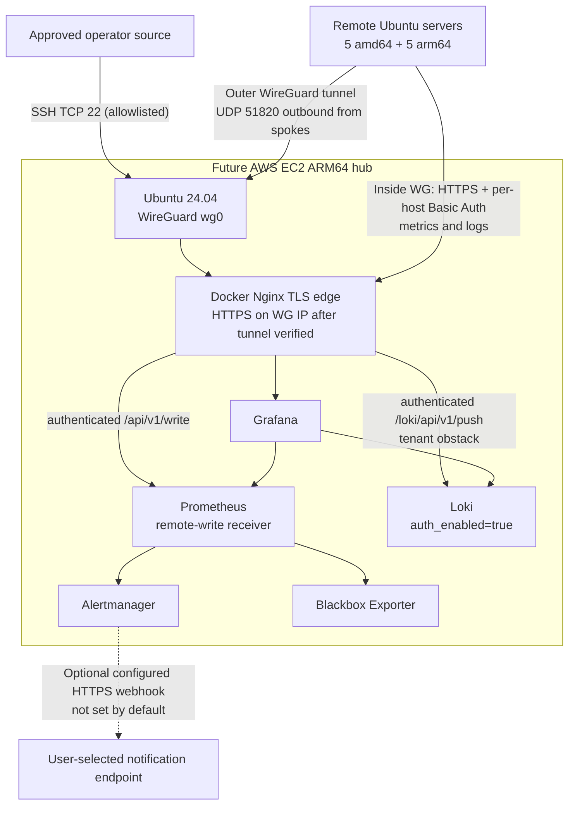

# ObStack operations: ports, capacity and failure modes

**Status:** design/runbook guidance for the repository implementation. Not a record of deployed host state. AWS VPC, Security Group, real host inventory, backup target and alert destination are not yet confirmed.

## Network diagram

The overlay 10.77.0.0/24 and hub address are provisional. The final VPC CIDR and all route-overlap checks must be completed before assigning addresses. The diagram represents the selected logical topology, not actual IP assignments or live connections.

The central Nginx ingestion endpoints and remote Alloy starter config do not mean remote sources are active. No application is currently enabled, `applications/policy.yml` has no approved WireGuard CIDR, and remote log/host collection is explicitly disabled until its source and privilege model are implemented. Application metrics scrape targets are generated only after network approval.

## Required ports

### Central host inbound

| Port/protocol | Source | Purpose | Policy |
|---|---|---|---|
| TCP 22 (default SSH) | Approved administrator IPv4 CIDR only | Ansible/SSH management | Keep existing access verified before applying UFW. The SSH port may be customized in inventory. |
| UDP 51820 | Verified enrolled remote static public egress IPv4 /32s | WireGuard hub listener | Restrict both AWS Security Group and host UFW. Confirm the egress IP observed by AWS; do not assume it equals SSH management address. |
| TCP 443 | WireGuard overlay peers/operators only, on the hub WG address | Nginx HTTPS | Keep AWS public TCP 443 closed. Bootstrap listener is loopback-bound until WireGuard is verified. |

No public inbound ports should be opened for Prometheus (9090), Loki (3100), Grafana (3000), Alertmanager (9093), Blackbox Exporter (9115), or remote exporters. The Compose host publications for these services bind to 127.0.0.1 only. Remote hosts do not need inbound WireGuard ports; they initiate outbound UDP 51820.

### Host-local publications and Docker service ports

| Service | Container port | Host publication | Access |
|---|---:|---|---|
| Nginx | TCP 443 | Configurable host IP:443 | Loopback during bootstrap; later WG IP only |
| Prometheus | TCP 9090 | 127.0.0.1:9090 | Local validation/operator tunnel only |
| Loki | TCP 3100 | 127.0.0.1:3100 | Local validation only |
| Grafana | TCP 3000 | 127.0.0.1:3000 | Behind Nginx |
| Alertmanager | TCP 9093 | 127.0.0.1:9093 | Local validation only |
| Blackbox Exporter | TCP 9115 | 127.0.0.1:9115 | Local validation only |

The Docker backend bridge carries inter-service connections. Validate effective Docker iptables/nftables and UFW rules after provisioning; Docker-published ports can interact with host firewall rules in ways that make a UFW-only assumption unsafe.

### Egress

The central host and spokes need outbound access for the explicitly required operations: Ubuntu package repositories and Docker image registries during installation/updates, WireGuard tunnel establishment/reconnect, and the configured HTTPS webhook destination if alert delivery is enabled. Exact egress restrictions and proxy needs depend on the future AWS and remote network policy.

## Initial central service resource ceilings

The current Compose limits sum to approximately 1,216 MiB of configured service memory ceilings and 1.65 vCPU of CPU ceilings. This is a configuration sum, not measured utilization or a capacity guarantee.

| Service | Memory ceiling | CPU ceiling |
|---|---:|---:|
| Nginx | 64 MiB | 0.10 |
| Prometheus | 384 MiB | 0.55 |
| Loki | 384 MiB | 0.45 |
| Grafana | 256 MiB | 0.30 |
| Alertmanager | 96 MiB | 0.15 |
| Blackbox Exporter | 48 MiB | 0.10 |
| **Total** | **1,216 MiB** | **1.65 vCPU** |

The host is fixed at 2 vCPU, 2 GB RAM and 14 GB disk for the pilot. The remaining memory must cover Ubuntu, Docker Engine, kernel, filesystem cache and overhead. Monitor host memory pressure and OOM events; these service caps do not establish that the overall host will remain stable.

### Storage caveats

- Prometheus has a 30-day time target and a 3 GB block-retention size cap. Size retention may delete older blocks before 30 days if ingest exceeds budget. WAL/head and compaction can create additional disk pressure beyond the block-size target.
- Loki is configured for 20-day retention on local filesystem storage, but there is no explicit hard disk-size cap for Loki in the current Compose configuration.
- The 14 GB disk must also contain Ubuntu, Docker image layers, service state/indexes, compaction overhead, backups (if local staging is used) and safe free-space headroom. No capacity guarantee can be made before ingestion measurements.
- Current Prometheus alerts cover TSDB block storage thresholds; they do **not** measure OS filesystem free space. Host filesystem alerts require verified host metrics.
- Upstream reference: [Prometheus local storage and retention](https://prometheus.io/docs/prometheus/latest/storage/).

## Failure-mode guide

| Failure | Detection/current behavior | Safe operator response | Test status |
|---|---|---|---|
| Central EC2 or Docker host unavailable | Single hub outage stops central queries and ingestion. Spoke buffering/retry behavior is not yet measured. | Restore host/instance and service health; check persisted volumes and agent queue/retry before considering data-loss impact. | Not tested; single-node SPOF. |
| WireGuard handshake or route fails for one spoke | That host's telemetry cannot reach central Nginx; recent handshake is not sufficient proof of ingestion. | Check source IP, UDP 51820 allowlist, peer key/AllowedIPs, endpoint, local routes and time sync; avoid widening ingress indiscriminately. | Pilot handshake/reconnect tests pending. |
| Prometheus scrape target down | PrometheusTargetMissing fires after 5 minutes for configured targets. | Check target service, network reachability, scrape config and labels. | Alert rule configured; delivery/real target test pending. |
| Prometheus config reload rejected | PrometheusConfigReloadFailed configured. | Run promtool check config/rules, inspect logs, correct config and validate before reload. | Rule configured; runtime simulation pending. |
| Prometheus block storage approaches cap | Warning/critical rules at configured thresholds. Retention may remove older blocks to respect size. | Measure ingestion/cardinality, check disk headroom and reduce unnecessary series or scale storage; do not assume the cap protects the whole filesystem. | CI syntax validation pending/current runs; runtime thresholds not exercised. |
| Filesystem fills or Loki storage grows unexpectedly | No host filesystem free-space alert yet; Loki has retention but no explicit volume size cap. | Inspect filesystem and Loki compactor/retention state; safely plan disk increase or ingestion reduction. Do not delete live data files manually. | Capacity baseline and recovery test pending. |
| Nginx certificate expires or CA trust is missing | TLS client verification fails; current central provisioning checks cert validity at deploy time, but no continuous expiry alert is implemented. | Verify CA chain/SAN, renew via reviewed procedure, distribute public CA only and validate pilot trust. | Rotation/expiry monitoring pending. |
| Metrics/log auth returns 401 | Nginx rejects credentials; per-host credential files are separate. | Verify correct host-specific secret, file permissions and rotation state. Avoid disabling Basic Auth/TLS. | Central read-only validation playbook exists; not run. |
| Alertmanager webhook is unset or endpoint fails | If OBSTACK_ALERTMANAGER_WEBHOOK_URL is unset, alerts route to the default sink and are not delivered. | Set an approved HTTPS endpoint via controller environment, re-run the reviewed central configuration, and test firing/resolved delivery. | Template checks are in CI; real delivery pending. |
| Existing remote Alloy agent ownership/config is unknown | Onboarding defaults to preserve and stages no changes. | Run read-only discovery; identify Compose owner, image, mounts, UID/GID and sources; backup and review before adopting. | Discovery not run against real hosts. |

## Recovery and readiness prerequisites still open

- Choose and secure an off-host backup target, encryption/key custody, backup retention, RPO/RTO and restoration procedure.
- Validate central and remote recovery on a staging pilot, including WireGuard peer revocation/re-enrolment and CA/certificate rotation.
- Establish measured daily metrics/log ingestion, retention achieved, filesystem free-space monitoring and scale-up trigger.
- Select actual alert destination and validate notifications.
- Approve real VPC/overlay CIDRs, source allowlists, pilot inventory and change windows.

No deployment or host changes are implied by this guide.
